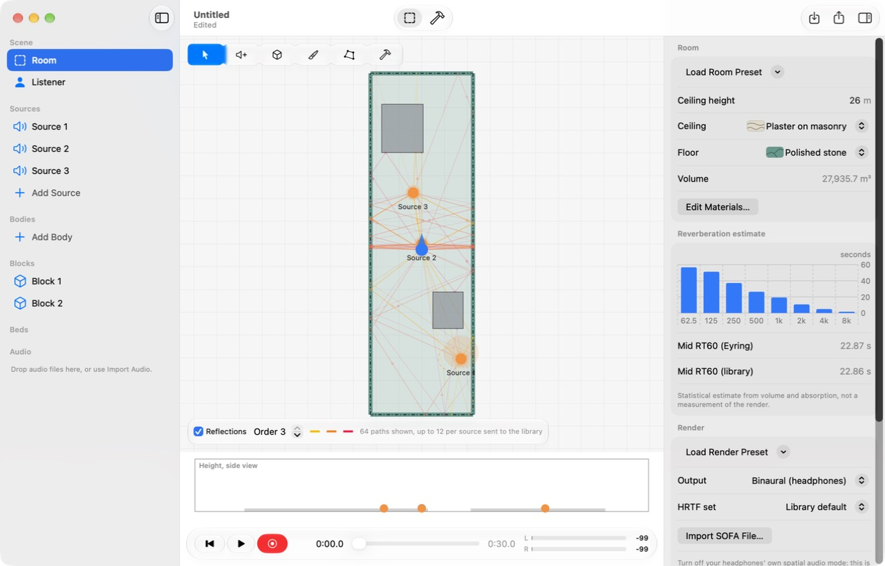
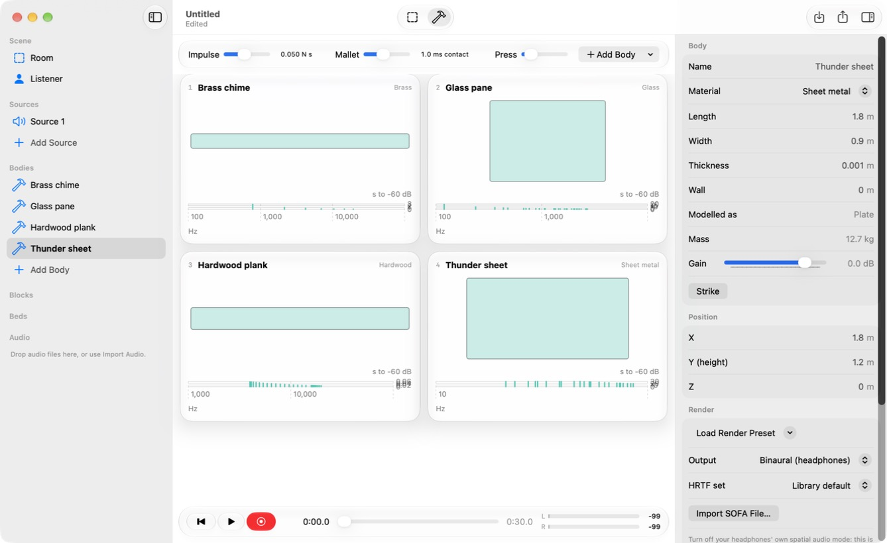
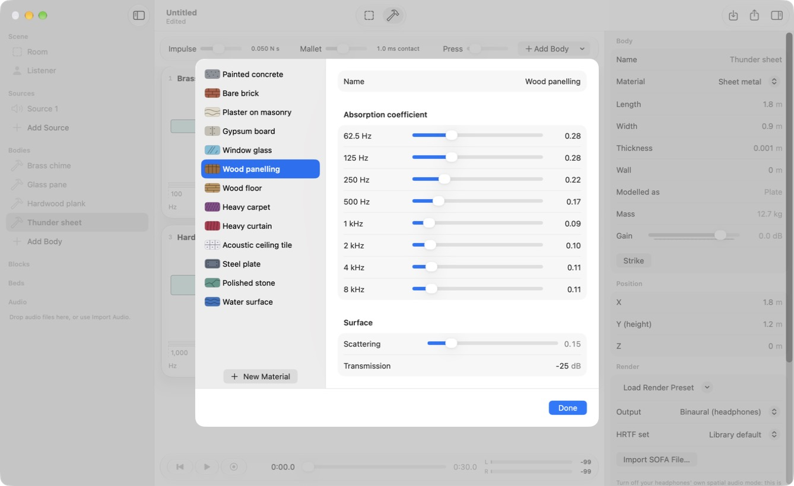

# Marathon Spatial

Spatial audio and physics-based audio for macOS, on any headphones. Open source under Apache-2.0.

Headphones play a finished binaural signal, so every model gets the same spatial result, shaped only by its own
sound. Bring your own audio, or let the physics of an object make the sound. Use it as a C library, or in Marathon
Spatial Studio, a native macOS 27 app.

> **Status: pre-release.** Interfaces may change. See [feature status](#feature-status) for what has landed.

## What it does

**Spatial audio**

- HRTF rendering with interpolation, plus your own SOFA files
- Near-field, ISO 9613-1 air absorption, Doppler, directivity and per-source filters
- Early reflections traced from live geometry, so moving doors and destruction change the sound
- Diffraction around the edges of live geometry: over a wall's top or round both corners of a pillar, with per-band wedge loss
- Baked probes for static scenes: a converged reverb field the moment a listener arrives, refined by the live field, and routes
  round any number of corners, still checked by live rays
- Hybrid late reverb in the listener's room: an energy field traced from the listener becomes a first-order ambisonic impulse
  response for convolution, and a feedback network carries the tail on at the level the field reached
- Late reverb per room, driven by real room volume and absorption, coupled through portals
- Higher-order ambisonic beds decoded through the same HRTFs
- Loudspeaker layouts from mono to 7.1.4 or your own: sources pan between speakers (VBAP), and the ambisonic mix with beds and
  reflections decodes to the layout (AllRAD, max-rE)
- Head tracking from any tracker you feed it
- One render path for live and offline, with bit-identical output however frames are chunked

**Physics-based audio**

- Modal analysis of closed meshes and closed-form bars, plates and blocks
- Modal synthesis with impacts, scrapes and rolling driven by contact forces
- Fracture, and plain-data material acoustics
- Recorded layers: one-shots, seamless loops and granular clouds driven by the same physics

**Bring your own audio**

- Any file Core Audio reads goes straight in as a source
- Place it in a room and render a binaural file, in the app or from code

## Marathon Spatial Studio

A native macOS 27 app built on the library: draw a room, place sources and sounding bodies, and hear the result on
headphones, or export it to a binaural WAV. Everything it plays or exports is rendered by the library.
See the [Studio README](apps/MarathonSpatialStudio/README.md).







## Requirements

- macOS 27 or later
- Apple M3 or later
- The macOS 27 SDK to build

There are no other platforms and no portability layer, by design. If you need Windows, Linux or mobile, or engine
plug-ins today, [Steam Audio](https://valvesoftware.github.io/steam-audio/) is the established choice. See the
[feature comparison](docs/COMPARISON_STEAM_AUDIO.md).

## Quick start

```sh
python3 demo/synthesize_demo_content.py demo/generated --verify
```

```sh
cmake -S . -B build -DCMAKE_BUILD_TYPE=Release
cmake --build build
build/examples/orbit_offline orbit.wav
```

Then open `orbit.wav` in any player. The examples write files and never open an audio device themselves.

The smallest use of the library:

```c
ms_engine_desc desc;
ms_engine_desc_default(&desc);
ms_engine* engine;
ms_engine_create(&desc, &engine);

ms_hrtf* hrtf;
ms_hrtf_create_sphere(0.0875f, desc.sample_rate, &hrtf);
ms_engine_set_hrtf(engine, hrtf);
ms_hrtf_release(hrtf);

ms_buffer buffer;
ms_buffer_load_file(engine, "sound.wav", &buffer);

ms_source source;
ms_source_create(engine, &source);
ms_source_set_buffer(engine, source, buffer, 0, 0);
ms_source_set_pose(engine, source, (ms_vec3){1, 0, -2}, (ms_vec3){0, 0, 0});
ms_source_play(engine, source, 0);
ms_engine_commit(engine);

ms_engine_render(engine, left, right, frames);
```

## Documentation

- [Building](docs/BUILDING.md)
- [API guide](docs/API.md)
- [Examples](examples/README.md)
- [Feature comparison with Steam Audio](docs/COMPARISON_STEAM_AUDIO.md)
- [Contributing](CONTRIBUTING.md)

## Listening

- **Turn off your headphones' own spatial mode**, and any spatial setting in macOS, for this output. A second
  spatializer on top of a binaural signal blurs both.
- **Try several HRTF sets.** Generic HRTFs have real limits on elevation and front-back cues, because everyone's
  ears differ. Choosing a set that suits you, and head tracking, both help.
- Measurements prove the cues are correct. Only your ears can judge whether it sounds real.

## Feature status

Marathon Spatial is being built in the open, and not everything above runs yet.

| Feature | State |
|---|---|
| Modal analysis, synthesis, contact, fracture and material acoustics | In the tree, with CPU tests |
| Reflection tracing on the CPU | In the tree, with CPU tests |
| Reflection tracing with Metal ray tracing | In the tree. Not yet run |
| Late reverb, room acoustics and portals | In the tree, with CPU tests |
| Convolution reverb from the traced energy field, hybrid with the feedback network | In the tree, with CPU tests; on by default in Studio |
| Edge diffraction, one or two edges, validated by rays | In the tree, with CPU tests; on by default |
| Baked probes: reverb fields and routes, saved as versioned files | In the tree, with CPU tests; through the C API |
| HRTF sets: analytic sphere, SOFA import, `.mshrtf` packs | In the tree, with CPU tests |
| Source, voice and bed rendering, the engine | In the tree, with CPU tests |
| Live Core Audio output | In the tree. Run on a Mac and listened to through Studio |
| Head tracking from headphone sensors | In the tree. Not yet checked on real headphones |
| Marathon Spatial Studio | Builds on the library, with offline render tests. Used and listened to on macOS 27 |
| Bundled measured HRTF sets | Four sets in [`data/hrtf`](data/hrtf/PROVENANCE.md) |
| Loudspeaker layouts: VBAP panning and an AllRAD decoder, mono to 7.1.4 and custom | In the tree, with CPU tests; through the C API |
| Multichannel live output: a channel per speaker, layout read from the device | In the tree, with CPU tests of the layout mapping and channel writing. Not yet run on a multichannel device |
| Stereo speaker path | In Studio: an equal-power pan with distance gain and no reflections |

Tests measure cues, levels and timing, and the author has listened to the result on headphones through Studio.

## Licence

Apache-2.0: see [LICENSE](LICENSE) and [NOTICE](NOTICE). Third party components keep their own licences, listed in
[THIRD_PARTY_NOTICES.md](THIRD_PARTY_NOTICES.md), including the citation the MIT KEMAR set asks for. Demo sounds are synthesized and dedicated to the public domain
under CC0-1.0, with [provenance](demo/PROVENANCE.md).
